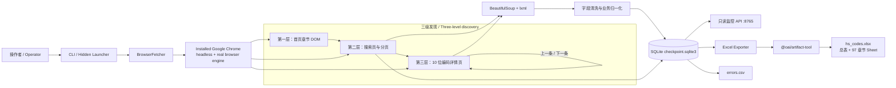
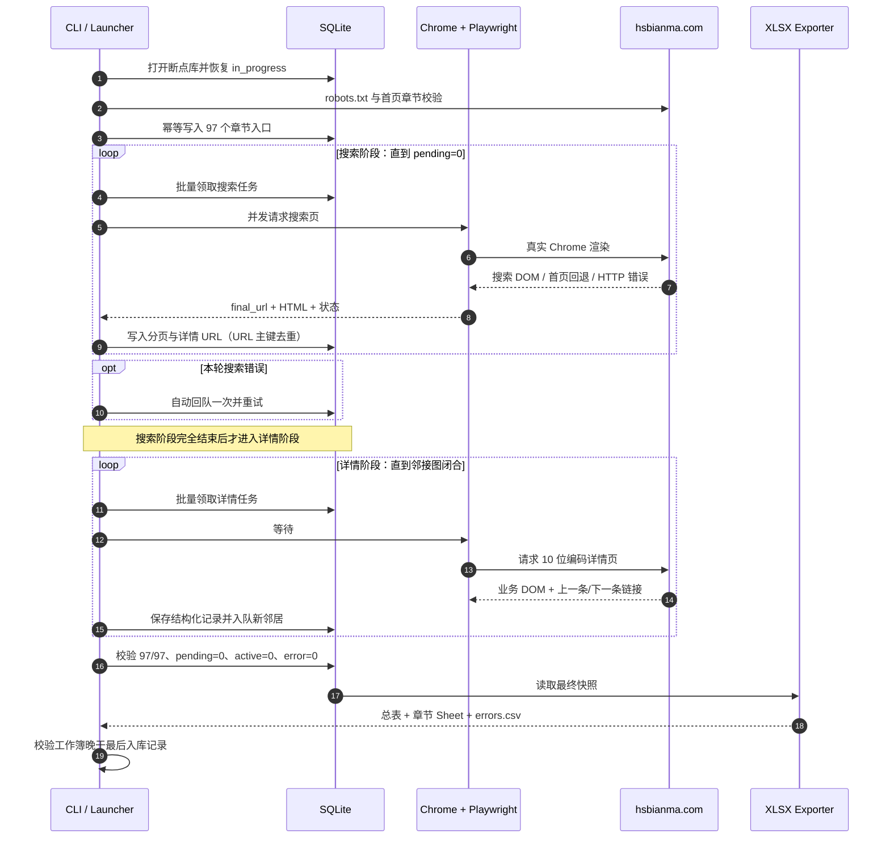

# HSBianma Crawler


一个可断点恢复、由真实 Chrome 内核渲染的 HS 编码全站采集器。它从章节入口发现搜索分页，抓取第三级详情 DOM，以 SQLite 保存任务与结构化记录，并导出“总表 + 章节 Sheet”的 Excel 工作簿。

A restartable, real-Chrome-rendered crawler for HS code data. It discovers chapter search pages, traverses third-level detail pages, checkpoints tasks and normalized records in SQLite, and exports an Excel workbook containing a master sheet plus one sheet per HS chapter.

[中文说明](#中文说明) · [English Guide](#english-guide)

---

## 中文说明

### 项目目标

站点数据分为三级：

1. **第一层：章节入口** - 首页 DOM 中的 97 个两位章节，范围为 `01-76`、`78-98`。
2. **第二层：搜索结果** - `/search?keywords=XX` 及其分页，负责发现详情 URL。
3. **第三层：编码详情** - `/Code/XXXXXXXXXX.html`，这是最终需要解析和导出的业务数据。

本项目不会把“当前队列暂时为空”直接当作全站完成。验收必须同时满足：97 个章节都有记录、搜索和详情任务全部清零、错误为零、数据库与工作簿一致。

### 架构连接图



### 采集 Workflow



### 核心特性

| 能力 | 实现 |
|---|---|
| 真实浏览器内核 | Playwright 驱动本机 Google Chrome，默认 headless |
| 并发控制 | `asyncio.Semaphore` + 浏览器上下文槽位池 |
| 访问节奏 | 令牌桶、随机延迟、指数退避、`Retry-After` |
| 请求画像 | 多组一致的 UA、`sec-ch-ua`、viewport、语言和时区 |
| 带宽控制 | 拦截图片、媒体和字体资源，只保留业务 DOM |
| HTTP 策略 | 区分成功、可重试、永久错误和访问拒绝 |
| DOM 诊断 | 超时时记录 `final_url`、标题、结果行数、首页树标记 |
| 断点恢复 | SQLite WAL；启动时将遗留 `in_progress` 恢复为 `pending` |
| 幂等去重 | `pages.url` 主键；`records.hs_code` 主键 + upsert |
| 运行内重试 | 搜索阶段结束后，将本轮搜索错误自动回队一次 |
| 完成门槛 | 97/97 章节覆盖、search/detail 队列全清零，且最终工作簿晚于最后入库记录 |
| Excel 导出 | 首 Sheet 为 `总表`，随后是两位章节 Sheet；中文表头、筛选、冻结窗格、原始 JSON |
| 隐藏启动 | Windows WMI `Win32_Process.Create` + `pythonw.exe`，避免长期终端黑框 |

### 技术栈

| 技术 | 用途 |
|---|---|
| Python 3.13+ | 异步调度、解析、归一化和 CLI |
| Playwright | Chrome 生命周期、页面导航、上下文隔离和 DOM 等待 |
| Google Chrome | 本机真实浏览器渲染内核 |
| BeautifulSoup + lxml | 搜索页、详情页和章节树解析 |
| asyncio | 并发批次、信号量、锁和异步重试 |
| SQLite WAL | 页面状态机、断点、去重和结构化 JSON 存储 |
| `@oai/artifact-tool` | XLSX 创建、样式、检查和渲染验证 |
| pytest + pytest-asyncio | 解析、队列、重试、浏览器策略、监控和导出测试 |
| PowerShell + WMI | Windows 隐藏启动、进程核验和端口管理 |
| Mermaid | GitHub 原生架构图与工作流图 |

### 安装要求

- Windows 10/11
- Python `>= 3.13`
- 本机 Google Chrome，默认路径：
  `C:\Program Files\Google\Chrome\Application\chrome.exe`
- Node.js 仅用于 Excel artifact builder；项目默认使用 Codex bundled Node，也可通过 `HS_CRAWLER_NODE_PATH` 覆盖

```powershell
python -m pip install -e .
```

### 快速开始

#### 1. 小规模冒烟测试

```powershell
python -m hs_crawler crawl `
  --output-dir smoke-data `
  --chapter 01 `
  --detail-limit 2 `
  --concurrency 2
```

#### 2. 保守的完整采集

```powershell
python -m hs_crawler crawl `
  --output-dir data `
  --concurrency 3 `
  --min-delay 1 `
  --max-delay 2 `
  --token-rate 1.2 `
  --token-capacity 2 `
  --retry-errors `
  --log-path logs/final.log
```

#### 3. Windows 隐藏高并发启动

> 该脚本使用并发 20、零延迟和高令牌速率。只应在你拥有访问权限并确认目标站点可以承受时使用。

```powershell
powershell.exe -NoProfile -ExecutionPolicy Bypass `
  -File .\tools\start_hs_hidden.ps1 `
  -Concurrency 20
```

先检查命令但不启动：

```powershell
powershell.exe -NoProfile -ExecutionPolicy Bypass `
  -File .\tools\start_hs_hidden.ps1 `
  -Concurrency 20 `
  -DryRun
```

隐藏启动器通过 WMI 创建 `pythonw.exe`，其父进程应为 `WmiPrvSE.exe`，不会长期依附当前 Codex/PowerShell 终端。

#### 4. 状态与监控

```powershell
python -m hs_crawler status --output-dir data

python -m hs_crawler.monitor `
  --data-dir data `
  --log-path logs/final.log `
  --host 127.0.0.1 `
  --port 8765
```

监控地址：<http://127.0.0.1:8765/>

监控进度取“已发现任务完成率”和“章节覆盖率”的较小值，因此缺章时不会再显示 100%。

#### 5. 从 SQLite 重建工作簿

```powershell
python -m hs_crawler export --output-dir data
```

输出文件：

```text
data/
├── checkpoint.sqlite3   # 断点与最终数据
├── hs_codes.xlsx        # 总表 + 章节 Sheet
└── errors.csv           # 最终错误清单
```

### 数据模型

#### `pages`

| 字段 | 说明 |
|---|---|
| `url` | 页面主键，保证幂等入队 |
| `kind` | `search` 或 `detail` |
| `chapter` | 两位 HS 章节 |
| `status` | `pending` / `in_progress` / `done` / `error` |
| `attempts` | 被领取次数 |
| `http_status` | 最近 HTTP 状态 |
| `error` | 最后错误与 DOM 诊断 |

#### `records`

| 字段 | 说明 |
|---|---|
| `hs_code` | 10 位编码主键 |
| `chapter` | 两位章节 |
| `source_url` | 第三级来源页面 |
| `data_json` | 完整标准化记录，包含原始 DOM 分区 JSON |
| `scraped_at_utc` | 采集时间 |

### Excel 结构

- 第一个 Sheet 固定为 `总表`
- 后续 Sheet 按两位章节排序
- 10 位编码按文本写入，保留前导 `0`
- 业务列使用中文表头
- 税率使用百分比格式，日期使用稳定格式
- 监管条件、检验检疫和层级路径整理为可筛选文本
- `原始数据(JSON)` 保留第三级 DOM 的完整解析结果
- 所有 Sheet 含筛选器、冻结表头、合理列宽和状态条件格式

### 验收标准

只有以下检查全部通过，才能把任务标记为完成：

```text
[ ] 首页发现 97 个章节
[ ] 97 个章节均至少有一条 records 数据
[ ] search_pending = 0
[ ] search_in_progress = 0
[ ] search_error = 0
[ ] detail_pending = 0
[ ] detail_in_progress = 0
[ ] detail_error = 0
[ ] records 数量等于 detail_done
[ ] HS 编码全部唯一、均为 10 位数字
[ ] data_json 与 raw_sections_json 全部非空且可解析
[ ] 工作簿首 Sheet 为“总表”
[ ] 后续 Sheet 与 97 个章节一一对应
[ ] 工作簿总表编码集合与 SQLite 完全一致
[ ] errors.csv 只有表头，无错误行
[ ] pytest 全量测试通过
```

### 踩过的坑与修复

| 现象 | 根因 | 修复 |
|---|---|---|
| 监控错误显示 100% | 只计算“已发现任务”的完成率，没有检查缺失章节 | 完成判定加入 97 章覆盖；进度取任务率与覆盖率较小值 |
| 部分章节为 0，但搜索页是 done | 站点偶发 HTTP 200 首页回退/空 DOM，零详情仍被当作成功 | 章节入口必须等到 `tr.result-grid`，零详情转为错误 |
| `--retry-errors` 后仍留下新错误 | 参数只在进程启动时回队旧错误 | 搜索阶段增加一次运行内错误回队 |
| 搜索异常只有 timeout，无法定位 | 错误缺少页面上下文 | 记录 `final_url`、title、result rows、`#tree1` 标记 |
| 详情数暂时不增长 | 搜索阶段与详情阶段有严格屏障 | 监控分别展示搜索状态和详情状态，避免误判为卡死 |
| 待办数一直约 23 | 多个章节各有一条“下一条”链，完成一条立即发现后继 | 对比 URL 快照；主键去重证明是移动窗口而非重复循环 |
| 普通 FetchError 后槽位耗尽 | 异常路径没有稳定归还或销毁浏览器槽位 | `finally` 式释放；断连槽位销毁并重建 |
| 浏览器请求走向 `127.0.0.1:7890` | 继承了失效的系统代理 | Chrome 增加 `--no-proxy-server` |
| 启动爬虫出现无法选中的黑框 | 长期子进程依附 Codex 的终端作业 | 使用 WMI + `pythonw.exe` 真正脱离终端 |
| 8765 偶发中断或读到 0 | 重复监控、进程切换和同步查询阻塞 | 保留单一监听者，状态使用后台缓存和只读 SQLite 连接 |
| 直接复制 SQLite 数据不完整 | WAL 中仍有未合并事务 | 使用 SQLite Online Backup API，而不是复制单个 `.sqlite3` 文件 |
| 控制台中文看起来乱码 | PowerShell/子进程输出编码与 UTF-8 不一致 | 以 UTF-8 文件内容和 XLSX XML 为准，校验时使用 Unicode 转义 |
| Excel 编码前导 0 看似丢失 | 渲染预览边缘裁切或数值自动推断 | 编码列写成文本，并直接检查 XLSX 单元格类型和值 |
| 中途导出被当成最终结果 | 队列尚未闭合，工作簿只是阶段快照 | 最终导出必须位于完整验收门之后 |
| 页面先显示“已完成”，表稍后才出现 | 监控只检查队列，没有检查导出文件新鲜度 | 工作簿未生成或早于最后入库记录时显示“导出中” |

### 项目结构

```text
.
├── src/hs_crawler/
│   ├── browser.py       # Chrome、槽位池、HTTP 策略、重试与 DOM 诊断
│   ├── crawler.py       # 三级发现、阶段屏障、邻接遍历
│   ├── parser.py        # 首页、搜索页、详情页 DOM 解析
│   ├── normalize.py     # 业务字段归一化
│   ├── store.py         # SQLite 状态机与幂等存储
│   ├── exporter.py      # 工作簿 payload 与 errors.csv
│   ├── monitor.py       # 只读状态 API 与缓存
│   └── cli.py           # crawl / status / export
├── tools/
│   ├── build_hs_workbook.mjs
│   └── start_hs_hidden.ps1
├── tests/
├── monitor.html
├── pyproject.toml
└── README.md
```

### 测试

```powershell
python -m pytest tests -q
```

测试覆盖解析、分页发现、详情邻接链、慢发现者竞态、运行内重试、浏览器槽位恢复、监控完成门槛和 Excel 导出。

### 合规使用

爬虫默认检查 `robots.txt`，不会处理 CAPTCHA、绕过登录或规避访问控制。请仅在你拥有授权的站点和速率范围内运行；高并发隐藏脚本不是默认推荐配置。

---

## English Guide

### Purpose

The site is traversed as a three-level graph:

1. **Level 1: chapter entry points** - 97 two-digit chapters from the home-page DOM (`01-76`, `78-98`).
2. **Level 2: search pages** - `/search?keywords=XX` and pagination links used to discover detail URLs.
3. **Level 3: detail pages** - `/Code/XXXXXXXXXX.html`, the business records that are normalized and exported.

An empty known queue is not sufficient proof of site-wide completion. Acceptance requires coverage of all 97 chapters, zero pending/active/error tasks, a workbook newer than the final database record, and an exact SQLite-to-XLSX reconciliation.

### Architecture

The architecture and sequence diagrams above are bilingual and represent the actual implementation. The important boundary is the stage barrier: search discovery drains completely before detail processing starts. Detail pages may discover additional same-chapter neighbors, so the detail stage continues until that graph reaches closure.

### Features

| Capability | Implementation |
|---|---|
| Browser rendering | Playwright drives the installed Google Chrome in headless mode |
| Concurrency | `asyncio.Semaphore` plus a bounded browser-context slot pool |
| Pacing | Token bucket, randomized delay, exponential backoff, `Retry-After` |
| Fingerprints | Coherent UA/client-hint/viewport profiles |
| Bandwidth reduction | Images, media, and fonts are aborted |
| HTTP handling | Success, retryable, permanent, and blocked responses are classified separately |
| Diagnostics | Selector failures include final URL, title, result-row count, and home-tree detection |
| Checkpointing | SQLite WAL with automatic recovery of interrupted in-progress tasks |
| Deduplication | URL primary key for pages; HS-code primary key with record upsert |
| Runtime retry | Search errors created in the current run are requeued once |
| Completion gate | 97/97 chapter coverage, clean queues, and a workbook newer than the final database record |
| Spreadsheet export | Chinese business headers, master sheet, chapter sheets, text identifiers, and raw JSON |
| Hidden Windows launch | WMI `Win32_Process.Create` launches `pythonw.exe` outside the terminal job |

### Requirements and installation

- Windows 10/11
- Python `>= 3.13`
- Installed Google Chrome
- Node.js for the spreadsheet artifact builder; a bundled runtime is used by default

```powershell
python -m pip install -e .
```

### Run

Conservative full crawl:

```powershell
python -m hs_crawler crawl `
  --output-dir data `
  --concurrency 3 `
  --min-delay 1 `
  --max-delay 2 `
  --token-rate 1.2 `
  --token-capacity 2 `
  --retry-errors `
  --log-path logs/final.log
```

Authorized high-throughput hidden launch:

```powershell
powershell.exe -NoProfile -ExecutionPolicy Bypass `
  -File .\tools\start_hs_hidden.ps1 `
  -Concurrency 20
```

Status, monitor, and export:

```powershell
python -m hs_crawler status --output-dir data

python -m hs_crawler.monitor `
  --data-dir data `
  --log-path logs/final.log `
  --host 127.0.0.1 `
  --port 8765

python -m hs_crawler export --output-dir data
```

Monitor: <http://127.0.0.1:8765/>

### Output

```text
data/
├── checkpoint.sqlite3
├── hs_codes.xlsx
└── errors.csv
```

The workbook starts with `总表` (master), followed by one sheet for each discovered two-digit chapter. Ten-digit identifiers are stored as text so leading zeroes remain intact. The raw JSON column preserves the complete parsed third-level DOM sections.

### Acceptance checklist

```text
[ ] 97 chapters discovered and covered by records
[ ] search pending / in_progress / error are all zero
[ ] detail pending / in_progress / error are all zero
[ ] record count equals detail done count
[ ] every HS code is unique and exactly ten digits
[ ] normalized JSON and raw section JSON are valid and non-empty
[ ] the first workbook sheet is 总表
[ ] chapter sheets match the 97 covered chapters
[ ] workbook master codes exactly match SQLite
[ ] workbook modification time is not older than the latest SQLite record
[ ] errors.csv has no data rows
[ ] the full pytest suite passes
```

### Lessons learned

- A `200 OK` response may still be a home-page fallback or empty shell. Validate DOM semantics, not only HTTP status.
- A progress bar based only on discovered work can report a false 100%. Chapter coverage belongs in the completion contract.
- A stable number of open tasks can be a moving neighbor-chain window, not a duplicate loop. Compare URL snapshots and enforce primary keys.
- Startup-only retry flags do not cover errors created later in the same run. Runtime retry must be explicit and bounded.
- Long-lived processes launched from an interactive agent terminal may leave unusable host panels. Detach through WMI and use `pythonw.exe`.
- Copying a live WAL database file is not a consistent backup. Use SQLite's online backup API.
- Console mojibake is not proof that the UTF-8 source or XLSX is corrupt. Verify bytes and workbook XML directly.
- A workbook generated during crawling is a snapshot, not a final deliverable.

### Responsible use

The crawler checks `robots.txt` by default and does not solve CAPTCHAs, bypass authentication, or defeat access controls. Run it only where you have authorization, and choose concurrency and pacing that the target can safely support.
